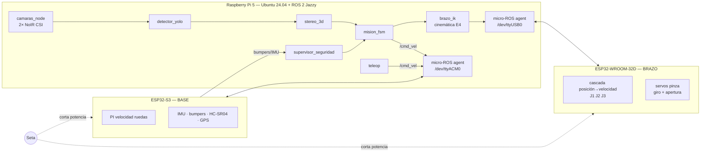
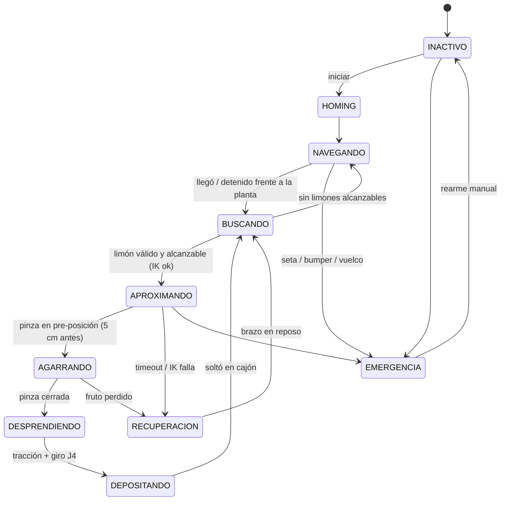

# Arquitectura — Robot recolector de limones "Arturito R2D2" (Grupo 2, 2026S2)

Versión 0.1 — 27/09/2026. Basada en `INDICE.md`, `elementos robot recogedor.md`, R1 E4–E5 y la revisión cruzada Claude/Codex.

---

## 1. Objetivo mínimo (lo que hay que lograr para aprobar)

> **El robot se desplaza hasta la planta, detecta un limón con YOLO, estima su posición 3D con las dos cámaras y lo agarra y desprende con el brazo, depositándolo en un cajón.**

Criterios de aceptación del mínimo:

| # | Criterio | Cómo se demuestra |
|---|---|---|
| M1 | La base se mueve controlada (teleoperada y un avance autónomo simple hasta la planta) | Video + rosbag de `/cmd_vel` y `/odom` |
| M2 | YOLO detecta limones en la imagen de la cámara del robot | Video con cajas + precisión/recobrado en un set de prueba propio |
| M3 | El estéreo da la posición 3D del limón en el marco del brazo | Error medido contra cinta métrica en ≥10 posiciones |
| M4 | El brazo llega a la posición, agarra, gira y retira el limón sin dañarlo | Video de ≥5 recolecciones seguidas |
| M5 | Todo corre en ROS 2 en la Pi, con parada de emergencia funcional | Diagrama de nodos (`rqt_graph`) + prueba de seta |

**Fuera del mínimo** (se agrega solo si el mínimo ya funciona): seguimiento de hilera por GPS, app móvil, clasificación por tamaño en 2 cajones, máquina de estados completa de la guía R2, autonomía de 45 min con batería, métricas de 30 frutos. Ver §10.

---

## 2. Vista general



Principio rector: **los lazos de control corren en los ESP32; la Pi solo manda consignas.** Si la Pi o el USB fallan, cada ESP32 se detiene solo (watchdog).

---

## 3. Reparto de hardware

Criterio: **un ESP32 por subsistema** (base y brazo), no "motores en uno y sensores en otro". Así el brazo se prueba solo para R1 y la base sola para R2, y cada uno reacciona localmente ante fallas.

| | **ESP32-S3 → BASE** | **ESP32-WROOM-32D → BRAZO** | **Raspberry Pi 5** |
|---|---|---|---|
| Motores | 2× DC 895 planetario 53 rpm con encoder (tracción) con 2× IBT-2 | J1: 36GP-555 160 rpm + IBT-2 · J2, J3: 2× 5840-31ZY + L298N | — |
| Encoders | 2 (Hall de rueda) → 2 de 4 PCNT | 3 (Hall J1 + 2 ópticos 1000 PPR) → 3 de 8 PCNT | — |
| Actuadores extra | luz, buzzer | 2 servos (apertura, giro J4) | — |
| Sensores | IMU MPU-6500 (I²C), 3 bumpers (frente y laterales), 3 HC-SR04, GPS UP501 (UART, ya probado en E1), monitor de batería, estado de seta | — | 2 cámaras NoIR (CSI), LiDAR (USB, fuera del mínimo) |
| Enlace | USB nativo → micro-ROS | USB (CH340) → micro-ROS | — |
| Watchdog | sin `/cmd_vel` por 300 ms → freno | sin comando por 300 ms → mantiene posición y frena | — |

Notas:
- Los HC-SR04 dan eco a 5 V: **divisor resistivo** a 3,3 V. Dispararlos en secuencia y sin `pulseIn` bloqueante.
- Las bibliotecas `BTS7960` y `EncoderPCNT` de la E5 no tienen pines fijos: se reutilizan tal cual en ambos ESP32.
- J1 cambia de placa respecto de la E5 (S3 → WROOM). Es solo reasignar pines.

---

## 4. Software ROS 2 (mínimo)

| Nodo | Dónde | Publica | Suscribe | Frec. |
|---|---|---|---|---|
| `base_fw` (micro-ROS) | ESP32-S3 | `/odom`, `/imu/data_raw`, `/bumpers`, `/range/{frente,izq,der}`, `/gps/fix`, `/battery`, `/base/estado`, `/base/respuesta` | `/cmd_vel`, `/base/comando` | 50 Hz (IMU), 25 Hz (odom), 10 Hz (rangos, bumpers) |
| `brazo_fw` (micro-ROS) | WROOM | `/brazo/joint_states`, `/brazo/estado`, `/brazo/respuesta` | `/brazo/joint_cmd`, `/pinza/cierre`, `/pinza/giro`, `/brazo/comando` | 20 Hz |
| `camaras_node` | Pi | `/stereo/left/image_raw`, `/stereo/right/image_raw` | — | 5–10 Hz |
| `detector_yolo` | Pi | `/limones/detecciones_2d` | imágenes | 3–5 Hz |
| `stereo_3d` | Pi | `/limones/posiciones` (marco `brazo_base`) | detecciones, `camera_info` | 3–5 Hz |
| `brazo_ik` | Pi | `/brazo/joint_cmd` | `/brazo/objetivo` | a demanda |
| `mision_fsm` | Pi | `/cmd_vel`, `/brazo/objetivo`, `/pinza/cierre`, `/pinza/giro`, `/base/comando`, `/brazo/comando` (`armar`) | posiciones, estados | 10 Hz |
| `supervisor_seguridad` | Pi | `/seguridad/parar` | `/bumpers`, `/imu`, estados, heartbeats | 20 Hz |
| `teleop` | Pi / notebook | `/cmd_vel` | joystick/teclado | — |

Los tópicos de los dos firmwares están implementados tal cual (ver el README de `firmware/base` y `firmware/brazo`); cada sesión con el agente arranca desarmada y hay que mandar `armar`. La cinemática inversa ya existe (R1 E4): se porta el código Python del notebook a un nodo `brazo_ik`, con los mismos filtros (límites, rama física, ángulo de transmisión).

---

## 5. Control de motores

La E5 identificó modelos de **velocidad** (`G_base = 1,58/(0,065s+1)`, `G_art = 1,33/(0,059s+1)`), así que el control es **en cascada**:

```
posición ref ──► [P posición, 50 Hz] ──► velocidad ref ──► [PI + feedforward, 100 Hz] ──► PWM ──► motor
                     ▲                                          ▲
                     └──────────── encoder (PCNT) ──────────────┘
```

- **Lazo interno** (velocidad, `Ts = 10 ms`): PI con `Ti = τ`, anti-windup, feedforward de zona muerta. Ganancias iniciales de la E5: base `Kp ≈ 0,41`, `Ki ≈ 6,3`; articulación `Kp ≈ 0,44`, `Ki ≈ 7,5`.
- **Lazo externo** (posición, solo brazo): P con saturación de velocidad y perfil trapezoidal.
- **Homing** al encender: cada articulación va lento hacia un final de carrera y fija el cero. Sin homing el brazo no acepta comandos.
- **Límites** articulares de E4 aplicados en el firmware (q1 ±75°, q2 −25…135°, q3 ±50°), además de en la IK.
- Detección de **atasco** (ya existe en la E5) → freno y estado de error.
- Las ruedas usan solo el lazo interno; `/cmd_vel` → velocidades de rueda en el ESP32-S3 (cinemática diferencial).

---

## 6. Visión: YOLO + estéreo

**Detección.** YOLO nano (YOLOv8n o YOLO11n) entrenado con clase `limon` (opcional: `limon_verde`), exportado a **NCNN** u **ONNX** para CPU de la Pi 5, entrada 320–416 px. Esperable: 3–8 FPS, suficiente porque el robot está detenido al recolectar.
- Dataset: imágenes públicas de limones + **≥200 fotos propias tomadas con las NoIR del robot** en la iluminación de la demo. Etiquetado en Roboflow o CVAT.
- Entrenamiento en la notebook o en Colab, no en la Pi.

**Posición 3D (método simple).** YOLO en las dos imágenes rectificadas → emparejar cajas de la misma fila (restricción epipolar) → disparidad `d = xL − xR` → `Z = f·B/d`, `X`, `Y` por proyección. Opcional: mediana de la disparidad SGBM dentro de la caja para robustez ante oclusión.

**Calibración** (en este orden, requiere **soporte rígido de cámaras**, hoy pendiente):
1. Intrínseca + estéreo con tablero (OpenCV, ya hay pruebas previas).
2. Cámara → base del brazo: llevar la pinza a 6–10 puntos conocidos, medirlos con el estéreo y ajustar la transformación rígida (`cv2.estimateAffine3D` o Kabsch). Publicarla como TF estática.

⚠ **Riesgo NoIR:** sin filtro IR los colores se alteran con luz solar. Probar **esta semana** si YOLO distingue el limón con estas cámaras; si no, conseguir un filtro IR-cut o cámaras con filtro. Entrenar siempre con imágenes de las mismas cámaras.

---

## 7. Secuencia de recolección (máquina de estados mínima)



Detalle de la recolección: **aproximación** a una pre-posición 5 cm delante del limón → avance recto → **cierre** de pinza → **tracción** (retroceso 1–2 cm) → **giro J4** de 90–180° → **retirada** → posición sobre el cajón → **apertura**.

Los nombres coinciden con los estados de la guía R2 (INACTIVO, NAVEGANDO, BUSCANDO, INTERVINIENDO≈APROXIMANDO…DEPOSITANDO, RECUPERACION, EMERGENCIA), así que luego se amplía sin rehacerla.

---

## 8. Seguridad mínima

1. **Hardware:** la seta corta la potencia de motores (su bloque NC A en el + del bus de 12 V, sin relé) sin pasar por software; los ESP32 y la Pi siguen encendidos y leen su estado. Rearme manual explícito, sin reinicio automático.
2. **Habilitación del brazo** con llave/relé separado (H8).
3. **ESP32:** watchdog de comandos, bumper → freno inmediato en la base, detección de atasco, límites articulares.
4. **Pi:** `supervisor_seguridad` lleva la misión a EMERGENCIA ante bumper, inclinación (IMU) o pérdida de heartbeat de cualquier ESP32.

J2 y J3 son de tornillo sin fin (irreversibles): al cortar potencia el brazo no cae. El riesgo es que la pinza suelte el limón; es aceptable.

---

## 9. Alimentación (a dimensionar)

- Rama **potencia 12 V**: IBT-2 ×3 + L298N, con fusible por rama.
- Rama **lógica**: Buck 5 V/5 A dedicado a la Pi 5 (fuente oficial o equivalente), Buck 5–6 V separado para los servos.
- Masa común en un único punto. Medir corriente pico con todos los motores arrancando.
- Para el mínimo se puede usar **fuente de laboratorio** (la guía permite no depender de batería).
- Batería (v0.6, 08/10): LiPo 3S directa para los motores y power bank de 5 V para la Pi y los ESP32; la 10S de
  36 V queda guardada (ver `CONEXIONES.md`).

⚠ **L298N:** cae ~2,4–3 V (en E5, 9,6 V efectivos, ~140 rpm máx.). Medir corriente y temperatura con el brazo cargado; si calienta o no alcanza par, reemplazar por un segundo IBT-2 o un puente MOSFET pequeño.

---

## 10. Plan de trabajo (4 personas en paralelo)

| Etapa | Brazo | Base | Visión | Integración / ROS |
|---|---|---|---|---|
| **1. Esta semana** | PI de velocidad J2 con carga (R1 E6) | Montar ruedas y motores, PI de ruedas | **Prueba NoIR + YOLO preentrenado con limones reales** | Definir tópicos (§4), agentes micro-ROS en la Pi |
| **2** | Cascada posición J1–J3 + homing + límites | `/cmd_vel` + watchdog + bumpers | Soporte rígido de cámaras + calibración estéreo | Nodo `brazo_ik` desde E4 |
| **3** | Pinza: cierre, giro, prueba de desprendimiento a mano | Teleop + odometría | Dataset propio + entrenar YOLO + `stereo_3d` | Calibración cámara→brazo |
| **4** | Brazo va a punto 3D publicado | Avance autónomo hasta la planta | Medir error 3D | `mision_fsm` mínima: detectar → agarrar |
| **5** | — | — | — | **Demo del mínimo (M1–M5)** |

Regla: **integrar una vez por semana** una versión de punta a punta, aunque sea parcial.

Después del mínimo, en este orden: 2 cajones por tamaño → seguimiento de hilera por GPS + visión → app móvil (rosbridge) → métricas de 30 frutos y rosbags → batería y autonomía.

---

## 11. Decisiones abiertas / preguntas para la cátedra

1. **R1: eje lineal de 1,2 m.** ¿La base móvil cumple ese rol?
2. ~~**Herramienta:** confirmar que se acepta **pinza + tracción + giro** en lugar de succión.~~ **Aprobado por el profesor** (28/09/2026): agarre y tracción con giro de la pinza, 2 servos RDS3218 de 20 kg·cm.
3. **GDL en R2:** B1 pide ≥4 GDL sin contar apertura (3R + J4 = 4 ✔), pero H6 dice "4 GDL + rotación". Confirmar que 3R + J4 alcanza.
4. **Cajones por tamaño:** ¿son obligatorios para el mínimo?
5. ~~**Mecanismo no Grashof** (E4)~~: el balancín rojo ya es de **60 mm** (2026-10-03) y el mecanismo es Grashof. Queda limitar γ₄ = q2 + q3 − 90° a −112°…−30° (μ entre 15° y 165°) en `brazo_ik` y en los límites de J2/J3.
6. **Cámaras NoIR:** ver §6.
