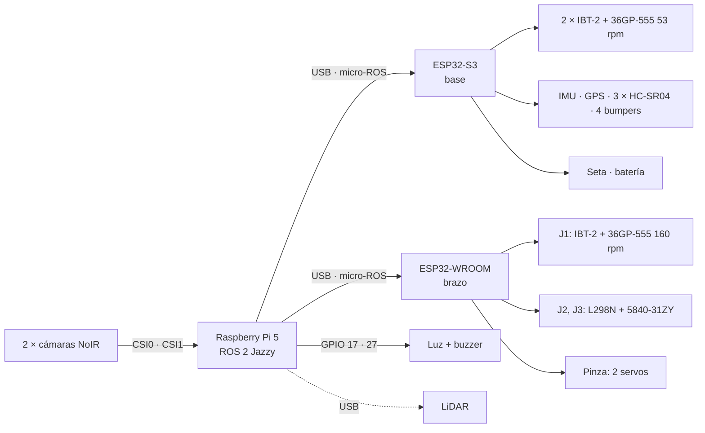

# Conexiones del robot

Versión 0.1 — 27/09/2026. Diagrama interactivo: `docs/conexiones.html` (abrir en el navegador).
Los pines salen de `firmware/brazo/include/pins.h` y `firmware/base/include/pins.h` (fuente de verdad). La
conexión de la Pi es una propuesta. Nada de esto está probado en placa todavía.



## ESP32-S3 · base

Freenove N16R8, USB nativo `/dev/ttyACM0`. Usa los 19 GPIO de uso general: no queda reserva.

| GPIO | Conecta a | Nota |
|---|---|---|
| 4 · 5 | IBT-2 izquierdo RPWM · LPWM | 20 kHz |
| 6 · 7 | IBT-2 derecho RPWM · LPWM | 20 kHz |
| 38 | R_EN + L_EN de los dos IBT-2 | pull-down 10 kΩ |
| 15 · 16 | Encoder izquierdo A · B | como en la prueba 06 |
| 17 · 18 | Encoder derecho A · B | |
| 8 · 9 | IMU SDA · SCL | 400 kHz, 0x68 |
| 41 · 42 | GPS: TX del GPS → RX1 · RX del GPS ← TX1 | 9600 8N1 |
| 10 | TRIG de los 3 HC-SR04 | disparo común |
| 11 · 12 · 13 | ECHO frente · izquierda · derecha | divisor 1 k / 2 k |
| 14 · 21 · 39 · 40 | Bumpers | NA a GND, pull-up interno |
| 47 | Contacto auxiliar **NC** de la seta | a GND, pull-up: HIGH = apretada o cable cortado |
| 1 | Divisor de batería 100 k / 27 k | ADC1 canal 0 |

## ESP32-WROOM-32D · brazo

DevKit con CH340, `/dev/ttyUSB0`. Fuente: `firmware/brazo/include/pins.h`.

| GPIO | Conecta a | Nota |
|---|---|---|
| 21 · 22 | J1 IBT-2 RPWM · LPWM | 20 kHz |
| 23 | J1 R_EN + L_EN | pull-down 10 kΩ |
| 34 · 35 | J1 encoder Hall A · B | pull-up externo 10 kΩ, encoder a 3V3 |
| 25 · 26 · 27 | J2 L298N ENA · IN1 · IN2 | 1 kHz, modo freno |
| 32 · 33 | J2 encoder A · B | 1000 PPR |
| 13 · 16 · 17 | J3 L298N ENB · IN3 · IN4 | 1 kHz, modo freno |
| 18 · 19 | J3 encoder A · B | 1000 PPR |
| 4 | Servo de apertura de la pinza | 50 Hz |
| 14 | Servo de giro J4 | pulsa durante el arranque |
| 36 · 39 | Finales de carrera J1 · J2 | pull-up externo 10 kΩ |

## Raspberry Pi 5 (propuesta)

| Puerto | Conecta a | Nota |
|---|---|---|
| CSI0 · CSI1 | Cámaras NoIR izquierda · derecha | cable de 15 a 22 pines |
| USB | ESP32-S3 (base) | micro-ROS |
| USB | ESP32-WROOM (brazo) | micro-ROS |
| USB | LiDAR | fuera del mínimo |
| GPIO 17 (pin 11) | Luz de estado | vía transistor |
| GPIO 27 (pin 13) | Buzzer | vía transistor |
| USB-C | Buck 5 V · 5 A | 27 W |

## Alimentación

```
Batería 12 V → interruptor general (H8) → fusible 15 A → bus 12 V
  ├─ Buck 5 V 5 A → Pi 5 (USB-C) → ESP32-S3 y WROOM por USB
  ├─ Buck 6 V 3 A → servos de la pinza (GND común con la WROOM)
  ├─ seta (NC) → relé de potencia (rearme manual)
  │     ├─ fusible 10 A → IBT-2 de tracción ×2
  │     └─ llave del brazo (H8) → fusible 5 A → IBT-2 J1 + L298N
  │   contacto auxiliar de la seta → S3 GPIO 47
  └─ divisor 100 k / 27 k → S3 GPIO 1 (12,6 V → 2,68 V; hasta ~15 V)
GND común en un solo punto.
```

La seta corta solo la potencia de los motores: la Pi y los ESP32 siguen encendidos. Para el objetivo mínimo el
bus de 12 V puede salir de una fuente de laboratorio.

## Antes de conectar

- [ ] Pull-down de 10 kΩ en cada EN: S3 GPIO 38; WROOM 23, 25 y 13.
- [ ] Divisor en cada ECHO del HC-SR04 (1 k arriba, 2 k abajo): el ECHO sale a 5 V.
- [ ] Pull-ups externos de 10 kΩ en WROOM 34, 35, 36 y 39 (no tienen pull-up interno).
- [ ] Encoder de J1 alimentado a 3V3 (a 5 V sus salidas pueden quedar a 5 V).
- [ ] Servos con su propio Buck y GND común con la WROOM.
- [ ] Cables de cámara de 15 a 22 pines para la Pi 5.
- [ ] Sin GPIO de reserva: si hace falta uno, un INA219 por I²C libera el ADC de la S3 y además mide corriente.
- [ ] LiDAR por USB en la Pi: los pines 14 y 21 que la prueba de la S3 reservaba para su UART ahora son bumpers.

## Decisiones de esta propuesta

- Un solo TRIG para los 3 HC-SR04: apuntan a lados distintos, así que casi no se interfieren.
- Un solo EN para los dos IBT-2 de tracción: la tracción se habilita y deshabilita completa.
- Luz y buzzer en la Pi: son indicadores del supervisor. La seta y los bumpers quedan en la S3 para que la base
  reaccione sola.
- Se respetan los pines ya probados en `~/pruebas-esp32`: IMU 8/9, GPS 41/42, motor 4/5, encoder 15/16.
