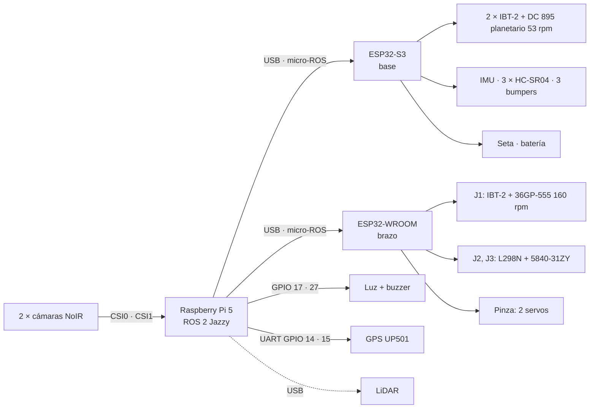

# Conexiones del robot

Versión 0.3 — 30/09/2026 (GPS en la Pi, un TRIG por HC-SR04; v0.2: alimentación con los buck disponibles). Diagrama interactivo: `docs/conexiones.html` (abrir en el navegador).
Los pines salen de `firmware/brazo/include/pins.h` y `firmware/base/include/pins.h` (fuente de verdad). La
conexión de la Pi es una propuesta. Nada de esto está probado en placa todavía.



## ESP32-S3 · base

Freenove N16R8, USB nativo `/dev/ttyACM0`. Usa 22 GPIO; queda libre el 40 (reservado por si la
cátedra pide el 4.º bumper). El GPS pasó a la Pi (30/09) para liberar dos TRIG.

| GPIO | Conecta a | Nota |
|---|---|---|
| 4 · 5 | IBT-2 izquierdo RPWM · LPWM | 20 kHz |
| 6 · 7 | IBT-2 derecho RPWM · LPWM | 20 kHz |
| 38 | R_EN + L_EN de los dos IBT-2 | pull-down 10 kΩ |
| 15 · 16 | Encoder izquierdo A · B | amarillo · blanco; ver "Antes de conectar" |
| 17 · 18 | Encoder derecho A · B | amarillo · blanco |
| 8 · 9 | IMU SDA · SCL | 400 kHz, 0x68 |
| 10 · 41 · 42 | TRIG del HC-SR04 central · esquina izq. · esquina der. | de a uno, cada 40 ms |
| 11 · 12 · 13 | ECHO frente · izquierda · derecha | divisor 1 k / 2 k |
| 14 · 21 · 39 | Bumpers frente · izquierda · derecha | NA a GND, pull-up interno (GPIO 40 queda libre) |
| 47 | Contacto auxiliar **NC** de la seta | a GND, pull-up: HIGH = apretada o cable cortado |
| 1 | Divisor de batería 120 k / 8,2 k | ADC1 canal 0 (42 V → 2,69 V) |

## ESP32-WROOM-32D · brazo

DevKit con CH340, `/dev/ttyUSB0`. Fuente: `firmware/brazo/include/pins.h`.

| GPIO | Conecta a | Nota |
|---|---|---|
| 21 · 22 | J1 IBT-2 RPWM · LPWM | 20 kHz |
| 23 | J1 R_EN + L_EN | pull-down 10 kΩ |
| 34 · 35 | J1 encoder Hall A · B | pull-up externo 10 kΩ, encoder a 3V3 |
| 25 · 26 · 27 | J2 L298N ENA · IN1 · IN2 | 1 kHz, modo freno |
| 32 · 33 | J2 encoder A · B | 1000 PPR |
| 13 · 16 · 17 | J3 L298N ENB · IN3 · IN4 | 1 kHz, modo freno |
| 18 · 19 | J3 encoder A · B | 1000 PPR |
| 4 | Servo de apertura de la pinza | 50 Hz |
| 14 | Servo de giro J4 | pulsa durante el arranque |
| 36 · 39 | Finales de carrera J1 · J2 | pull-up externo 10 kΩ |

## Raspberry Pi 5 (propuesta)

**Ubicación: la Pi y las cámaras juntas, arriba del mástil.** Las NoIR van a la Pi por cable plano CSI (22 pines del
lado de la Pi 5), que es corto y sensible a interferencias; los ESP32 van por USB, que aguanta 1-2 m sin problema.
Así: soporte rígido en el mástil (adelante a la derecha, con el brazo atrás sobre el eje, como en la simulación) con las dos cámaras
y la Pi 5 con su disipador activo; bajan por el mástil los 2 cables USB a los ESP32 (con ferrite) y la alimentación.
El buck de 5 V (buck 2) va **arriba, al lado de la Pi** (con 5 A, un cable de 5 V largo cae demasiado y la Pi se
queja de tensión baja): por el mástil sube el bus de 12 V de lógica (buck 1-B), que lleva poca corriente (~1,5 A).
Alternativa si la Pi tiene que ir abajo: cables CSI de 22 a 15 pines de 300-500 mm (existen hasta 1 m, pero a más
largo más riesgo de errores de imagen); los adaptadores CSI→HDMI no están garantizados con la Pi 5.

Los GPIO se atornillan en un **HAT pasivo de borneras** (40 pines a tornillo; `docs/fotos/HAT_pi_5/`): no agrega
pines ni protección. Usar punteras en los cables y ver que no choque con el disipador ni tape los CSI.

| Puerto | Conecta a | Nota |
|---|---|---|
| CSI0 · CSI1 | Cámaras NoIR izquierda · derecha | cable de 15 a 22 pines |
| USB | ESP32-S3 (base) | micro-ROS |
| USB | ESP32-WROOM (brazo) | micro-ROS |
| USB | LiDAR | fuera del mínimo |
| GPIO 14 · 15 (pines 8 · 10) | GPS UP501: RX del GPS · TX del GPS | UART0, `/dev/ttyAMA0`, 9600; GPS a 3,3 V |
| GPIO 17 (pin 11) | Luz de estado | vía transistor |
| GPIO 27 (pin 13) | Buzzer | vía transistor |
| USB-C | Buck 2 (12 → 5,1 V, 8 A) | `usb_max_current_enable=1` |

## Alimentación

Batería real: **YONGZHI 10S2P de 18650, 36 V nominales, 4400 mAh (158 Wh), 135 × 90 × 60 mm, XT60**, de
hoverboard (con BMS de corriente sin documentar). Tensión real: **~42 V cargada**, 36 V nominal, ~30-32 V descargada.
Los motores son de 12 V, el IBT-2 aguanta 27 V como máximo y el L298N 46 V: los motores van por un buck 36 → 12 V.

### Buck disponibles (29/09, `docs/fotos/bucks/`)

| | Módulo | Entrada | Salida | Corriente | ¿Aguanta 42 V? | Uso |
|---|---|---|---|---|---|---|
| **1** (×1) | 400 W CC/CV, fusible de entrada 15 A | **10,5-60 V** | 0-45 V (≤ 0,8·Vin) | 12 A continuos (280 W) ventilado; 15 A con ventilador | **sí** | 36 → 12,5 V, bus de motores |
| **2** (×1) | XL4016 300 W (Realpoy) | 7-32 V | 0,8-28 V | 8 A (ventilador arriba de 65 °C) | no | 12 → 5,1 V, Pi 5 |
| **3** (×2) | XL4016 200 W (LIZAO) | 4-38 V | 1,25-36 V | 5 A continuos, 8 A pico | no | 12 → 6 V servos; el otro de repuesto |
| **4** (×1) | 300 W 20 A CC/CV | 6-40 V | 1,2-36 V | 15 A continuos, 20 A pico | no | repuesto (o bancos con fuente ≤ 36 V) |

**Solo el buck 1 se puede conectar a la batería.** Los otros tres se queman con la batería cargada (42 V): van
colgados de un bus de 12 V. Falta **un segundo buck 1** (Gs. ~106 000) para separar la lógica de los motores.
El buck 1 no tiene protección contra corriente que vuelve por la salida (lo dice el vendedor: con motores, diodo).

```
Batería 10S 36 V (30-42 V) → fusible 15 A junto al borne → interruptor general DC (H8) → bus 36 V
  ├─ Buck 1-A (36 → 12,5 V, CC 14 A, ventilador) → diodo Schottky ≥ 30 A → relé 12 V 40 A (bobina por la seta NC)
  │     └─ bus 12 V de motores (capacitor 2200 µF 25 V + TVS 15 V, p. ej. 5KP15A)
  │           ├─ fusible 15 A → IBT-2 de tracción ×2
  │           ├─ llave del brazo (H8) → fusible 5 A → IBT-2 J1 + L298N (J2, J3)
  │           └─ fusible 3 A → Buck 3 (12 → 6 V, CC 5 A) → 2 servos RDS3218 (GND común con la WROOM)
  ├─ fusible 3 A → Buck 1-B (36 → 12 V, CC 3 A) → bus 12 V de lógica, sube por el mástil
  │     ├─ Buck 2 (12 → 5,1 V), arriba al lado de la Pi → Pi 5 (USB-C) → ESP32-S3 y WROOM por USB
  │     └─ ventilador del Buck 1-A · luz y buzzer (vía transistor)
  │   contacto auxiliar NC de la seta → S3 GPIO 47
  └─ divisor 120 k / 8,2 k → S3 GPIO 1 (42 V → 2,69 V; con 11 dB mide hasta ~46 V)
GND común en un solo punto.
```

- **Seta:** corta el bus de motores del lado de 12 V con un relé automotriz común de 12 V 40 A (a 12 V DC sí
  cortan bien; a 42 V DC haría falta un contactor especial). La seta enclava sola: se rearma girándola, y las dos
  placas arrancan desarmadas igual. **Los servos quedan dentro de la seta**: la pinza se afloja al apretarla.
- **Diodo, capacitor y TVS:** el Schottky no deja que la corriente de frenado vuelva al buck; esa energía la toma el
  capacitor, y el TVS recorta si el bus sube (el IBT-2 aguanta 27 V). El diodo cae ~0,5 V: por eso el buck va a 12,5 V.
- **Corriente:** el CC del buck 1-A (14 A) es el límite de los motores. Consumo a 12 V: tracción 2 × 2,6 A en vacío
  y 2 × 5,5 A nominal (10 A bloqueado cada uno), J1 y J2/J3 unos pocos A, servos ~1-3 A a 6 V. Si un motor se traba,
  el buck limita y baja la tensión. Por eso la lógica va por el buck 1-B. Desde la batería: ≤ 14 A × 12,5 V / 0,93
  / 30 V ≈ 6,3 A para motores + ~1,5 A de lógica, cómodo para el BMS.
- **Pi 5 por buck (sin USB-PD):** poner `usb_max_current_enable=1` en `/boot/firmware/config.txt`; si no, la Pi
  limita los USB a 600 mA entre todos.
- **Mientras no esté el segundo buck 1:** la lógica sale del mismo 12 V del buck 1 **antes del relé** (con un
  diodo y 2200 µF de respaldo antes del buck 2). Un motor trabado lleva el buck a CC y puede reiniciar la Pi:
  solo para pruebas. Para el banco, el bus de motores puede salir de una fuente de laboratorio sin la batería.

## Antes de conectar

- [ ] **Batería de 36 V (42 V cargada):** a la batería solo el buck 1 (los buck 2, 3 y 4 llegan a 32-40 V: se
      queman). **Ajustar cada buck sin carga y con el multímetro antes de conectarle nada** (tensión y CC). Divisor
      de batería **120 k / 8,2 k** (el viejo de 100 k / 27 k pondría ~8,9 V en el GPIO 1 y lo quema). Cargar solo
      con su cargador de 42 V, con el robot apagado.
- [ ] Conectar el XT60 con el interruptor general abierto (el interruptor, apto para DC, se lleva la chispa de los
      capacitores de entrada). Respetar la polaridad: el buck 1 tiene fusible, pero la salida al revés lo rompe.
- [ ] Schottky ≥ 30 A con disipador, 2200 µF 25 V y TVS de 15 V en el bus de motores; ventilador sobre el buck 1-A.
- [ ] Pull-down de 10 kΩ en cada EN: S3 GPIO 38; WROOM 23, 25 y 13.
- [ ] Divisor en cada ECHO del HC-SR04 (1 k arriba, 2 k abajo): el ECHO sale a 5 V.
- [ ] Pull-ups externos de 10 kΩ en WROOM 34, 35, 36 y 39 (no tienen pull-up interno).
- [ ] Encoder de J1 alimentado a 3V3 (a 5 V sus salidas pueden quedar a 5 V).
- [ ] Encoders de tracción (42GM-895H): azul = Vcc 5-24 V, verde = GND, amarillo = A, blanco = B; motor en negro y
      rojo. Salida con pull-up interno de 10 kΩ a Vcc: alimentados a 5 V, **A y B salen a 5 V** y la S3 no los
      tolera. Poner 20 kΩ de cada salida a GND (con el pull-up interno queda en ~3,3 V) y medir con el multímetro,
      girando despacio, que el alto no pase de 3,3 V antes de conectar a la S3.
- [ ] Servos con su propio buck (buck 3, CC en 5 A) y GND común con la WROOM. Son RDS3218 de 20 kg·cm: el de
      apertura queda bloqueado apretando el limón y cada uno puede pedir del orden de 2-3 A trabado (confirmar).
- [ ] Cables de cámara de 15 a 22 pines para la Pi 5.
- [ ] Sin GPIO de reserva: si hace falta uno, un INA219 por I²C en el bus de **12 V de motores** mide su corriente
      (en el de 36 V no: el INA219 llega a 26 V; ahí haría falta un INA228).
- [ ] LiDAR por USB en la Pi: los pines 14 y 21 que la prueba de la S3 reservaba para su UART ahora son bumpers.

## Decisiones de esta propuesta

- Un TRIG por HC-SR04, disparados de a uno: los 3 miran al frente (0°, ±15°) y con el TRIG común uno podía tomar
  el eco de otro. Cada sensor mide cada 120 ms (~8 Hz; a 0,25 m/s, 3 cm).
- GPS en la Pi (UART del header, vía el HAT de borneras): no es de seguridad, queda arriba del mástil con cielo
  despejado y liberó 41/42 de la S3. Driver: `nmea_navsat_driver` (ver `firmware/base/README.md`).
- Un solo EN para los dos IBT-2 de tracción: la tracción se habilita y deshabilita completa.
- Luz y buzzer en la Pi: son indicadores del supervisor. La seta y los bumpers quedan en la S3 para que la base
  reaccione sola.
- Se respetan los pines ya probados en `~/pruebas-esp32`: IMU 8/9, motor 4/5, encoder 15/16.
