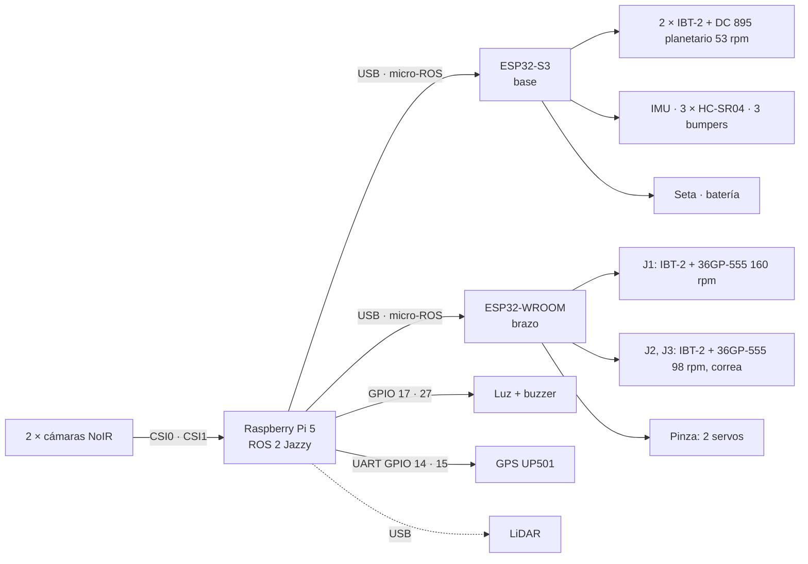

# Conexiones del robot

Versión 0.4 — 05/10/2026 (J2 y J3 pasan a 36GP-555 98 rpm con IBT-2 y correa; lógica desde la LiPo 3S; consumo
y autonomía. v0.3: GPS en la Pi, un TRIG por HC-SR04). Diagrama interactivo, circuito de potencia y autonomía:
`docs/conexiones.html` (abrir en el navegador). Los pines de la S3 salen de `firmware/base/include/pins.h`. Los de la
WROOM (v0.4) están en `firmware/brazo/include/pins.h` desde el 05/10 (J2/J3 sin probar hasta que lleguen los
motores); la conexión de la Pi sigue siendo una propuesta. Probado en placa: J1 y, con los motores viejos, J2/J3 (`pruebas-esp32/10`).



## ESP32-S3 · base

Freenove N16R8, USB nativo `/dev/ttyACM0`. Usa 22 GPIO; queda libre el 40 (reservado por si la
cátedra pide el 4.º bumper). El GPS pasó a la Pi (30/09) para liberar dos TRIG.

| GPIO | Conecta a | Nota |
|---|---|---|
| 4 · 5 | IBT-2 izquierdo RPWM · LPWM | 20 kHz |
| 6 · 7 | IBT-2 derecho RPWM · LPWM | 20 kHz |
| 38 | R_EN + L_EN de los dos IBT-2 | pull-down 10 kΩ |
| 15 · 16 | Encoder izquierdo A · B | amarillo · blanco; ver "Antes de conectar" |
| 17 · 18 | Encoder derecho A · B | amarillo · blanco |
| 8 · 9 | IMU SDA · SCL | 400 kHz, 0x68 |
| 10 · 41 · 42 | TRIG del HC-SR04 central · esquina izq. · esquina der. | de a uno, cada 40 ms |
| 11 · 12 · 13 | ECHO frente · izquierda · derecha | divisor 1 k / 2 k |
| 14 · 21 · 39 | Bumpers frente · izquierda · derecha | NA a GND, pull-up interno (GPIO 40 queda libre) |
| 47 | Contacto auxiliar **NC** de la seta | a GND, pull-up: HIGH = apretada o cable cortado |
| 1 | Divisor de batería 120 k / 8,2 k | ADC1 canal 0 (42 V → 2,69 V) |

## ESP32-WROOM-32D · brazo (v0.4)

DevKit con CH340, `/dev/ttyUSB0`. Tres IBT-2 con un solo EN; queda libre el GPIO 13.

| GPIO | Conecta a | Nota |
|---|---|---|
| 21 · 22 | J1 IBT-2 RPWM · LPWM | 20 kHz (probado) |
| 25 · 26 | J2 IBT-2 RPWM · LPWM | empezar como J1; probar 1 kHz (con el 5840 rendía más) |
| 16 · 17 | J3 IBT-2 RPWM · LPWM | igual que J2 |
| 23 | R_EN + L_EN de los 3 IBT-2 | pull-down 10 kΩ; quietos = frenados (EN alto, PWM 0) |
| 34 · 35 | J1 encoder A · B | pull-up externo 10 kΩ |
| 32 · 33 | J2 encoder A · B | pull-up interno |
| 18 · 19 | J3 encoder A · B | pull-up interno |
| 4 | Servo de apertura de la pinza | 50 Hz |
| 14 | Servo de giro J4 | pulsa durante el arranque |
| 36 · 39 · 27 | Finales de carrera (cero) J1 · J2 · J3 | 36/39 pull-up externo 10 kΩ; 27 interno |
| 13 | libre | reserva |

Motores 36GP-555 (J1, J2, J3), encoder SCX-555 de 16 PPR (64 cuentas por vuelta del motor), salida de colector abierto
(pull-ups de 5,1 kΩ en la placa), 3,3-5 V, alimentado aparte del motor: blanco = motor +,
amarillo = motor −, verde = encoder + (**3V3**), azul = GND, negro = A, rojo = B. J1 160 rpm (50:1) con correa
18 → 90; J2 y J3 98 rpm (82:1) con correa (relación a definir). A 12 V: 0,5 A en vacío, 1,3 A nominal, 10 A
trabado. **No se autobloquean** (planetarios): sin corriente el brazo cae.

## Raspberry Pi 5 (propuesta)

**Ubicación: la Pi y las cámaras juntas, arriba del mástil.** Las NoIR van a la Pi por cable plano CSI (22 pines del
lado de la Pi 5), que es corto y sensible a interferencias; los ESP32 van por USB, que aguanta 1-2 m sin problema.
Así: soporte rígido en el mástil (adelante a la derecha, con el brazo atrás sobre el eje, como en la simulación) con las dos cámaras
y la Pi 5 con su disipador activo; bajan por el mástil los 2 cables USB a los ESP32 (con ferrite) y la alimentación.
El buck de 5 V (buck 2) va **arriba, al lado de la Pi** (con 5 A, un cable de 5 V largo cae demasiado y la Pi se
queja de tensión baja): por el mástil sube el bus de lógica, la LiPo 3S directa (9,9-12,6 V), que lleva poca corriente (~1,5 A).
Alternativa si la Pi tiene que ir abajo: cables CSI de 22 a 15 pines de 300-500 mm (existen hasta 1 m, pero a más
largo más riesgo de errores de imagen); los adaptadores CSI→HDMI no están garantizados con la Pi 5.

Los GPIO se atornillan en un **HAT pasivo de borneras** (40 pines a tornillo; `docs/fotos/HAT_pi_5/`): no agrega
pines ni protección. Usar punteras en los cables y ver que no choque con el disipador ni tape los CSI.

| Puerto | Conecta a | Nota |
|---|---|---|
| CSI0 · CSI1 | Cámaras NoIR izquierda · derecha | cable de 15 a 22 pines |
| USB | ESP32-S3 (base) | micro-ROS |
| USB | ESP32-WROOM (brazo) | micro-ROS |
| USB | LiDAR | fuera del mínimo |
| GPIO 14 · 15 (pines 8 · 10) | GPS UP501: RX del GPS · TX del GPS | UART0, `/dev/ttyAMA0`, 9600; GPS a 3,3 V |
| GPIO 17 (pin 11) | Luz de estado | vía transistor |
| GPIO 27 (pin 13) | Buzzer | vía transistor |
| USB-C | Buck 2 (LiPo 9,9-12,6 → 5,1 V, 8 A) | `usb_max_current_enable=1` |

## Alimentación (v0.4: dos baterías)

- **Motores: YONGZHI 10S2P de 18650**, 36 V nominales (30-42 V), 4400 mAh (158 Wh), 135 × 90 × 60 mm, XT60, BMS de
  hoverboard sin documentar.
- **Lógica: LiPo Zeee 3S1P** 11,1 V (9,9-12,6 V), 8000 mAh (88,8 Wh), 100C, Deans (T), balanceo JST-XH, 493 g,
  **sin BMS**. Voltímetro LED de 2 hilos (4,5-30 V) en el bus de lógica: solo para mirar (no sirve en la 10S: 42 V).

Separadas, un motor trabado no puede hacer caer la tensión de la Pi, y ya no hace falta el segundo buck 1. Los motores
son de 12 V y el IBT-2 aguanta 27 V como máximo: van por el buck 1 (36 → 12,5 V).

### Buck disponibles (29/09, `docs/fotos/bucks/`)

| | Módulo | Entrada | Salida | Corriente | ¿Aguanta 42 V? | Uso |
|---|---|---|---|---|---|---|
| **1** (×1) | 400 W CC/CV, fusible de entrada 15 A | **10,5-60 V** | 0-45 V (≤ 0,8·Vin) | 12 A continuos (280 W) ventilado; 15 A con ventilador | **sí** | 10S → 12,5 V, bus de motores |
| **2** (×1) | XL4016 300 W (Realpoy) | 7-32 V | 0,8-28 V | 8 A (ventilador arriba de 65 °C) | no | LiPo → 5,1 V, Pi 5 |
| **3** (×2) | XL4016 200 W (LIZAO) | 4-38 V | 1,25-36 V | 5 A continuos, 8 A pico | no | 12 → 6 V servos; el otro de repuesto |
| **4** (×1) | 300 W 20 A CC/CV | 6-40 V | 1,2-36 V | 15 A continuos, 20 A pico | no | repuesto |

El buck 1 no tiene protección contra la corriente que vuelve por la salida (lo dice el vendedor: con motores, diodo).

```
Batería 10S 36 V (30-42 V) → fusible 15 A ≥ 58 V DC junto al borne → interruptor de motores (≥ 20 A, ≥ 60 V DC) → bus 36 V
  ├─ Buck 1 (36 → 12,5 V, CC 14 A, ventilador) → Schottky ≥ 30 A → relé 12 V 40 A (bobina por la seta NC)
  │     │  (1N4007 en paralelo con la bobina: cátodo al +)
│     └─ bus 12 V de motores (2200 µF 25 V + TVS 15 V, p. ej. 5KP15A)
  │           ├─ fusible 15 A → IBT-2 de tracción ×2
  │           ├─ llave del brazo (H8) → fusible 10 A → IBT-2 J1 + IBT-2 J2 + IBT-2 J3
  │           └─ fusible 3 A → Buck 3 (12 → 6 V, CC 5 A) → 2 servos RDS3218 (GND común con la WROOM)
  └─ divisor 120 k / 8,2 k → S3 GPIO 1 (42 V → 2,69 V)

LiPo 3S (9,9-12,6 V) → fusible 5 A junto al conector → interruptor de lógica → bus 12 V de lógica (sube por el mástil)
  ├─ Buck 2 (→ 5,1 V), arriba al lado de la Pi → Pi 5 (USB-C) → ESP32-S3 y WROOM por USB
  ├─ ventilador del buck 1 · luz y buzzer (vía transistor) · bobina del relé a través de la seta NC
  ├─ INA219 en el I²C de la S3 (0x40): tensión y corriente de la LiPo (a comprar)
  └─ alarma de LiPo en el conector de balanceo (a comprar)
  contacto auxiliar NC de la seta → S3 GPIO 47
GND: los negativos de las dos baterías unidos en un solo punto (los positivos nunca).
```

- **Seta:** corta el bus de motores del lado de 12 V con un relé automotriz de 12 V 40 A (a 42 V DC haría falta
  un contactor especial). La bobina se alimenta de la LiPo a través de la seta: los motores, el brazo y los servos se
  apagan y la Pi y los ESP32 siguen encendidos. La seta enclava y se rearma girándola. La S3 se desarma sola
  (rearme con `r`); la WROOM no ve la seta y seguiría armada, así que `mision` la desarma al ver `SETA` en
  `/base/estado` y queda en FALLA (relanzarla para seguir). **Sin `mision` corriendo (brazo a mano), mandar
  `desarmar` antes de soltar la seta.** **Con la seta, J2 y J3 sueltan el brazo** (no se autobloquean): mientras
  no haya freno, un contrapeso o un resorte hecho con lo que haya que lo lleve al reposo.
- **Margen del bus de 12 V:** el TVS 5KP15A empieza a conducir a ~16,7 V pero puede llegar a 24,4 V en un pico, y
  el capacitor es de 25 V: justo. No frenar la tracción de golpe ni mover tracción y brazo a la vez (el buck 1 queda
  al límite: 11 A de tracción + 3,9 A del brazo en nominal). Si en el inventario hay un capacitor de 35 V, usar ese.
- **Diodo, capacitor y TVS:** el Schottky no deja que la corriente de frenado vuelva al buck; esa energía la toma el
  capacitor, y el TVS recorta si el bus sube (el IBT-2 aguanta 27 V). El diodo cae ~0,5 V: por eso el buck va a 12,5 V.
- **Corriente:** el CC del buck 1 (14 A) es el límite de los motores. Tracción (42GM-895H a 12 V): 2,6 A en vacío,
  5,5 A nominal y 10 A trabado cada uno; brazo (36GP-555): 0,5 / 1,3 / 10 A cada uno; servos ~1-3 A a 6 V. Desde
  la 10S: ≤ 14 A × 12,5 V / 0,93 / 30 V ≈ 6,3 A, cómodo para el BMS. La LiPo da ~1,5 A (pico ~2 A).
- **LiPo sin BMS:** la Pi la descarga sin parar y el buck 2 no corta por tensión baja. No bajar de 3,5 V por celda
  (10,5 V): alarma en el balanceo y el INA219 para que la Pi se apague sola. Cargar solo con un cargador balanceador.
- **Pi 5 por buck (sin USB-PD):** `usb_max_current_enable=1` en `/boot/firmware/config.txt`; si no, la Pi limita
  los USB a 600 mA entre todos.

### Consumo y autonomía (estimados; medir con el INA219 o una pinza)

| Carga | Potencia |
|---|---|
| Tracción avanzando a 0,25 m/s (2 × 60 % × 12 V × 3 A) | ~43 W |
| Tracción girando o en terreno malo | ~70 W |
| Brazo moviéndose (J1-J3 + servos) | ~26 W |
| Brazo quieto sosteniendo (J2/J3 contra el peso + pinza) | ~6 W |
| Lógica: Pi 5 con YOLO (~9 W), ESP32 (0,8 W), sensores (0,6 W), buck 2 (1,2 W), relé + ventilador + luz (3,5 W) | ~15 W |

Ciclo de cosecha por limón (60 s): 20 s avanzando, 5 s maniobrando, 25 s con el brazo en movimiento y 10 s con el brazo quieto
→ 32 W en el bus de motores, 37 W desde la 10S. Energía útil: 80 % de la nominal.

| Batería | Útil | Consumo | Autonomía |
|---|---|---|---|
| 10S, ciclo de cosecha | 126 Wh | 37 W | **~3,4 h** |
| 10S, avanzando sin parar | 126 Wh | ~55 W | ~2,3 h |
| 10S, terreno malo sin parar | 126 Wh | ~80 W | ~1,6 h |
| LiPo, lógica | 71 Wh | 15 W | **~4,7 h** |

El robot dura lo que dura la 10S, **~3,4 h de cosecha**. Con todo desde la 10S serían ~2,4 h, y con los motores en la LiPo ~2,1 h.
La batería de hoverboard puede tener 20-30 % menos de lo que dice la etiqueta: medirla con un ciclo completo.

## Antes de conectar

- [ ] **Dos baterías, un solo GND:** negativos de la 10S y la LiPo unidos en un punto, positivos nunca.
- [ ] **LiPo:** fusible de 5 A pegado al conector (100C: un cortocircuito son cientos de amperes), alarma en el
      balanceo, no bajar de 10,5 V, cargador balanceador.
- [ ] **J2 y J3 no se sostienen solos:** al desarmar o con la seta el brazo cae; reposo apoyado en un tope.
- [ ] **Batería de 36 V (42 V cargada):** a la batería solo el buck 1 (los buck 2, 3 y 4 llegan a 32-40 V: se
      queman). **Ajustar cada buck sin carga y con el multímetro antes de conectarle nada** (tensión y CC). Divisor
      de batería **120 k / 8,2 k** (el viejo de 100 k / 27 k pondría ~8,9 V en el GPIO 1 y lo quema). Cargar solo
      con su cargador de 42 V, con el robot apagado.
- [ ] Conectar el XT60 con el interruptor general abierto (el interruptor, apto para DC, se lleva la chispa de los
      capacitores de entrada). Respetar la polaridad: el buck 1 tiene fusible, pero la salida al revés lo rompe.
- [ ] Schottky ≥ 30 A con disipador, 2200 µF 25 V y TVS de 15 V en el bus de motores; ventilador sobre el buck 1-A.
- [ ] Pull-down de 10 kΩ en cada EN: S3 GPIO 38 y WROOM 23 (un EN para los 3 IBT-2 del brazo).
- [ ] Divisor en cada ECHO del HC-SR04 (1 k arriba, 2 k abajo): el ECHO sale a 5 V.
- [ ] Pull-ups externos de 10 kΩ en WROOM 36 y 39 (finales de carrera; no tienen pull-up interno). En 34/35
      (encoder de J1) alcanza el de 5,1 kΩ de la SCX-555: medir que esté; si no, 10 kΩ a 3V3.
- [ ] Encoders de J1, J2 y J3 a 3V3 (la SCX-555 trae pull-ups de 5,1 kΩ a su Vcc: a 5 V las salidas quedan a 5 V).
- [ ] Bumpers y finales de carrera: microinterruptores V-152-1C25 (SPDT, rodillo). Común a GND y NA al GPIO, sin
      alimentación; con cables largos, 100 nF a GND en el pin.
- [ ] Encoders de tracción (42GM-895H): azul = Vcc 5-24 V, verde = GND, amarillo = A, blanco = B; motor en negro y
      rojo. Salida con pull-up interno de 10 kΩ a Vcc: alimentados a 5 V, **A y B salen a 5 V** y la S3 no los
      tolera. Poner 20 kΩ de cada salida a GND (con el pull-up interno queda en ~3,3 V) y medir con el multímetro,
      girando despacio, que el alto no pase de 3,3 V antes de conectar a la S3. Antes, medir sin alimentar la
      resistencia de cada salida a Vcc (≈ 10 kΩ = colector abierto con pull-up: el divisor vale; si es push-pull,
      el divisor tiene que ser 10 k / 20 k en serie y no solo 20 k a GND).
- [ ] **IBT-2 a 3,3 V:** leer el integrado de entrada de los 5 módulos. Con 74HC244 a 5 V el alto mínimo es
      3,5 V y los 3,3 V del ESP32 quedan fuera de hoja (suele andar, sin margen): probar cada uno a 20 kHz y, si
      falla, alimentar su VCC a 4,5 V o menos o usar un 74HCT si aparece en el inventario.
- [ ] **LED RGB de la S3:** ver la revisión de la DevKitC-1. En la v1.1 el RGB está en el GPIO 38 (EN de la
      tracción): nunca usar el RGB en el firmware (`pins.h` lo supone en el 48) o pasar el EN a otro pin.
- [ ] **Servo de giro (WROOM 14):** el GPIO 14 saca pulsos al arrancar; conectar los 6 V de los servos después de
      que la WROOM arrancó, o pasar la señal al GPIO 13 (libre).
- [ ] **LEDs de la Freenove:** además de bumpers y seta, medir si cargan el GPIO 1 (divisor de 7,7 kΩ: un LED
      cambia mucho la lectura de batería), los encoders (15-18) y el I²C (8/9). Si cargan, sacar ese LED.
- [ ] **Divisor de batería con la lógica apagada:** la 10S sigue empujando ~2,7 V al GPIO 1 por 120 kΩ (≤ 0,3 mA).
      Encender primero la lógica y apagarla última; no dejar la 10S conectada con la S3 apagada mucho tiempo.
- [ ] Servos con su propio buck (buck 3, CC en 5 A) y GND común con la WROOM. Son RDS3218 de 20 kg·cm: el de
      apertura queda bloqueado apretando el limón y cada uno puede pedir del orden de 2-3 A trabado (confirmar).
- [ ] Cables de cámara de 15 a 22 pines para la Pi 5.
- [ ] GPIO de reserva: S3 40 (sin ADC) y WROOM 13. El INA219 de la LiPo comparte el I²C de la IMU (0x40).
- [ ] LiDAR por USB en la Pi: los pines 14 y 21 que la prueba de la S3 reservaba para su UART ahora son bumpers.

## Decisiones de esta propuesta

- Un TRIG por HC-SR04, disparados de a uno: los 3 miran al frente (0°, ±15°) y con el TRIG común uno podía tomar
  el eco de otro. Cada sensor mide cada 120 ms (~8 Hz; a 0,25 m/s, 3 cm).
- GPS en la Pi (UART del header, vía el HAT de borneras): no es de seguridad, queda arriba del mástil con cielo
  despejado y liberó 41/42 de la S3. Driver: `nmea_navsat_driver` (ver `firmware/base/README.md`).
- Un solo EN para los dos IBT-2 de tracción: la tracción se habilita y deshabilita completa.
- Luz y buzzer en la Pi: son indicadores del supervisor. La seta y los bumpers quedan en la S3 para que la base
  reaccione sola.
- Se respetan los pines ya probados en `~/pruebas-esp32`: IMU 8/9, motor 4/5, encoder 15/16.
