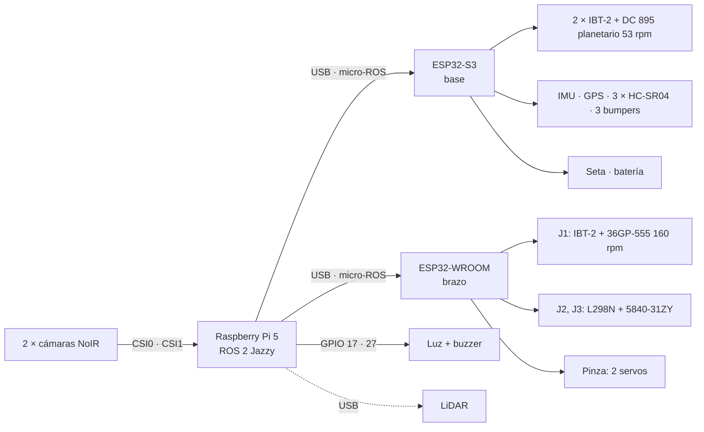

# Conexiones del robot

Versión 0.1 — 27/09/2026. Diagrama interactivo: `docs/conexiones.html` (abrir en el navegador).
Los pines salen de `firmware/brazo/include/pins.h` y `firmware/base/include/pins.h` (fuente de verdad). La
conexión de la Pi es una propuesta. Nada de esto está probado en placa todavía.



## ESP32-S3 · base

Freenove N16R8, USB nativo `/dev/ttyACM0`. Usa los 19 GPIO de uso general: no queda reserva.

| GPIO | Conecta a | Nota |
|---|---|---|
| 4 · 5 | IBT-2 izquierdo RPWM · LPWM | 20 kHz |
| 6 · 7 | IBT-2 derecho RPWM · LPWM | 20 kHz |
| 38 | R_EN + L_EN de los dos IBT-2 | pull-down 10 kΩ |
| 15 · 16 | Encoder izquierdo A · B | amarillo · blanco; ver "Antes de conectar" |
| 17 · 18 | Encoder derecho A · B | amarillo · blanco |
| 8 · 9 | IMU SDA · SCL | 400 kHz, 0x68 |
| 41 · 42 | GPS: TX del GPS → RX1 · RX del GPS ← TX1 | 9600 8N1 |
| 10 | TRIG de los 3 HC-SR04 | disparo común |
| 11 · 12 · 13 | ECHO frente · izquierda · derecha | divisor 1 k / 2 k |
| 14 · 21 · 39 | Bumpers frente · izquierda · derecha | NA a GND, pull-up interno (GPIO 40 queda libre) |
| 47 | Contacto auxiliar **NC** de la seta | a GND, pull-up: HIGH = apretada o cable cortado |
| 1 | Divisor de batería 120 k / 8,2 k | ADC1 canal 0 (42 V → 2,69 V) |

## ESP32-WROOM-32D · brazo

DevKit con CH340, `/dev/ttyUSB0`. Fuente: `firmware/brazo/include/pins.h`.

| GPIO | Conecta a | Nota |
|---|---|---|
| 21 · 22 | J1 IBT-2 RPWM · LPWM | 20 kHz |
| 23 | J1 R_EN + L_EN | pull-down 10 kΩ |
| 34 · 35 | J1 encoder Hall A · B | pull-up externo 10 kΩ, encoder a 3V3 |
| 25 · 26 · 27 | J2 L298N ENA · IN1 · IN2 | 1 kHz, modo freno |
| 32 · 33 | J2 encoder A · B | 1000 PPR |
| 13 · 16 · 17 | J3 L298N ENB · IN3 · IN4 | 1 kHz, modo freno |
| 18 · 19 | J3 encoder A · B | 1000 PPR |
| 4 | Servo de apertura de la pinza | 50 Hz |
| 14 | Servo de giro J4 | pulsa durante el arranque |
| 36 · 39 | Finales de carrera J1 · J2 | pull-up externo 10 kΩ |

## Raspberry Pi 5 (propuesta)

**Ubicación: la Pi y las cámaras juntas, arriba del mástil.** Las NoIR van a la Pi por cable plano CSI (22 pines del
lado de la Pi 5), que es corto y sensible a interferencias; los ESP32 van por USB, que aguanta 1-2 m sin problema.
Así: soporte rígido en el mástil (adelante a la derecha, con el brazo atrás sobre el eje, como en la simulación) con las dos cámaras
y la Pi 5 con su disipador activo; bajan por el mástil los 2 cables USB a los ESP32 (con ferrite) y la alimentación.
El buck de 5 V va **arriba, al lado de la Pi** (con 5 A, un cable de 5 V largo cae demasiado y la Pi se queja de
tensión baja): por el mástil sube el bus de 12 V (o 36 V si el buck lo acepta), que lleva poca corriente.
Alternativa si la Pi tiene que ir abajo: cables CSI de 22 a 15 pines de 300-500 mm (existen hasta 1 m, pero a más
largo más riesgo de errores de imagen); los adaptadores CSI→HDMI no están garantizados con la Pi 5.

| Puerto | Conecta a | Nota |
|---|---|---|
| CSI0 · CSI1 | Cámaras NoIR izquierda · derecha | cable de 15 a 22 pines |
| USB | ESP32-S3 (base) | micro-ROS |
| USB | ESP32-WROOM (brazo) | micro-ROS |
| USB | LiDAR | fuera del mínimo |
| GPIO 17 (pin 11) | Luz de estado | vía transistor |
| GPIO 27 (pin 13) | Buzzer | vía transistor |
| USB-C | Buck 5 V · 5 A | 27 W |

## Alimentación

Batería real: **YONGZHI 10S2P de 18650, 36 V nominales, 4400 mAh (158 Wh), 135 × 90 × 60 mm, XT60**, de
hoverboard (con BMS). Tensión real: **~42 V cargada**, 36 V nominal, ~30-32 V descargada. Los motores son de 12 V,
el IBT-2 aguanta 27 V como máximo y el L298N 46 V: los motores van por un **buck 36 → 12 V de alta corriente**.

```
Batería 10S 36 V (30-42 V) → interruptor general (H8) → fusible 20 A → bus 36 V
  ├─ Buck 36 → 12 V (lógica), entrada ≥ 45 V → sube por el mástil
  │     └─ Buck 12 → 5 V 5 A, arriba al lado de la Pi → Pi 5 (USB-C) → ESP32-S3 y WROOM por USB
  ├─ Buck 36 → 6 V ≥ 5 A, entrada ≥ 45 V → 2 servos RDS3218 de la pinza (GND común con la WROOM)
  ├─ seta (NC) → relé de potencia apto para 36 V DC (rearme manual)
  │     └─ Buck 36 → 12 V ≥ 25 A (≥ 300 W), entrada ≥ 45 V → bus 12 V de motores
  │           ├─ fusible 15 A → IBT-2 de tracción ×2
  │           └─ llave del brazo (H8) → fusible 5 A → IBT-2 J1 + L298N (J2, J3)
  │   contacto auxiliar de la seta → S3 GPIO 47
  └─ divisor 120 k / 8,2 k → S3 GPIO 1 (42 V → 2,69 V; con 11 dB mide hasta ~46 V)
GND común en un solo punto.
```

Consumo a 12 V: tracción 2 × 5,5 A nominal (2 × 10 A bloqueados), J1 y J2/J3 unos pocos A: pico de ~25-30 A a 12 V
(~10 A de la batería). La seta corta solo la potencia de los motores: la Pi y los ESP32 siguen encendidos. Para las
pruebas de banco el bus de 12 V de motores puede salir de una fuente de laboratorio (sin la batería conectada).

## Antes de conectar

- [ ] **Batería de 36 V (42 V cargada):** todos los buck con entrada de ≥ 45 V (los LM2596 comunes llegan a 40 V: no
      sirven), relé de la seta apto para 36 V DC, y el **divisor de batería 120 k / 8,2 k** (el viejo de 100 k / 27 k
      pondría ~8,9 V en el GPIO 1 y lo quema). Cargar solo con su cargador de 42 V.
- [ ] Pull-down de 10 kΩ en cada EN: S3 GPIO 38; WROOM 23, 25 y 13.
- [ ] Divisor en cada ECHO del HC-SR04 (1 k arriba, 2 k abajo): el ECHO sale a 5 V.
- [ ] Pull-ups externos de 10 kΩ en WROOM 34, 35, 36 y 39 (no tienen pull-up interno).
- [ ] Encoder de J1 alimentado a 3V3 (a 5 V sus salidas pueden quedar a 5 V).
- [ ] Encoders de tracción (42GM-895H): azul = Vcc 5-24 V, verde = GND, amarillo = A, blanco = B; motor en negro y
      rojo. Salida con pull-up interno de 10 kΩ a Vcc: alimentados a 5 V, **A y B salen a 5 V** y la S3 no los
      tolera. Poner 20 kΩ de cada salida a GND (con el pull-up interno queda en ~3,3 V) y medir con el multímetro,
      girando despacio, que el alto no pase de 3,3 V antes de conectar a la S3.
- [ ] Servos con su propio Buck y GND común con la WROOM. Son RDS3218 de 20 kg·cm: el de apertura queda bloqueado
      apretando el limón y cada uno puede pedir del orden de 2-3 A trabado (confirmar con la hoja): Buck de 5 A o más.
- [ ] Cables de cámara de 15 a 22 pines para la Pi 5.
- [ ] Sin GPIO de reserva: si hace falta uno, un INA219 por I²C libera el ADC de la S3 y además mide corriente.
- [ ] LiDAR por USB en la Pi: los pines 14 y 21 que la prueba de la S3 reservaba para su UART ahora son bumpers.

## Decisiones de esta propuesta

- Un solo TRIG para los 3 HC-SR04: apuntan a lados distintos, así que casi no se interfieren.
- Un solo EN para los dos IBT-2 de tracción: la tracción se habilita y deshabilita completa.
- Luz y buzzer en la Pi: son indicadores del supervisor. La seta y los bumpers quedan en la S3 para que la base
  reaccione sola.
- Se respetan los pines ya probados en `~/pruebas-esp32`: IMU 8/9, GPS 41/42, motor 4/5, encoder 15/16.
