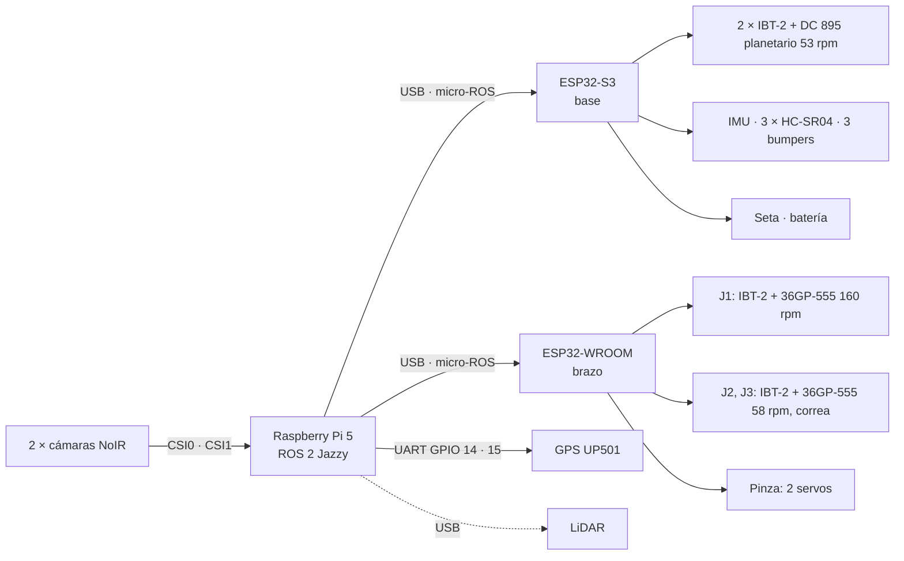

> **Versión anterior (v0.7, hasta el 14/10/2026).** Pines de la S3 sin ordenar por lado. La vigente es `docs/CONEXIONES.md` (v0.8).

# Conexiones del robot

Versión 0.6 — 08/10/2026 (09/10: **la LiPo pasa a XT60** porque no hay Deans hembra, par de XT60 en `fotos/conectores/`; **la seta ya está**, `fotos/llaves/`): **los motores van con la LiPo 3S directa** (sin buck 1 ni Schottky; la 10S queda guardada) y
**la Pi con el power bank Xiaomi PB2020MI**. Divisor de batería 100 k / 30 k (firmware cambiado). **Protección de la
LiPo: fusible de auto de 20 A** pegado al XT60; la térmica CHINT queda solo como interruptor (no está certificada en DC). `html/conexiones.html` y
`html/placa_s3.html` ya están en la v0.6.
10/10: **sale la térmica CHINT**: el ON/OFF de los motores es el **selector WEG** (2 bloques BC10 NA 3-4 en paralelo) y
la **seta trae 2 bloques NC** (fotos traseras en `fotos/llaves/`). Detalle cable por cable, con fotos: `html/potencia.html`.
10/10 (v0.7): **la seta corta el + del bus de 12 V** (bloque A entre el selector y la bornera +12 V; decisión del grupo,
más simple y corta también el brazo y los servos) y el bloque B avisa al GPIO 47. El EN de la tracción ya no pasa por
la seta. Cable por cable: `html/seta.html`.
v0.5 — 08/10/2026: **potencia solo con lo que hay** (térmica CHINT C10, XT60, cable, borneras, capacitores
(hay, falta buscarlos) y resistencias; seta y Schottky todavía no están, se consiguen). Sin relé, TVS, Schottky ≥ 30 A ni
fusibles. La Pi 5 pasa al power bank.
v0.4 — 05/10/2026 (J2 y J3 pasan a 36GP-555 58 rpm con IBT-2 y correa; lógica desde la LiPo 3S; consumo
y autonomía. v0.3: GPS en la Pi, un TRIG por HC-SR04). Diagrama interactivo, circuito de potencia y autonomía:
`docs/html/conexiones.html` (abrir en el navegador). Los pines de la S3 salen de `firmware/base/include/pins.h`. Los de la
WROOM (v0.4) están en `firmware/brazo/include/pins.h` desde el 05/10 (J2/J3 sin probar hasta que lleguen los
motores); la conexión de la Pi sigue siendo una propuesta. Probado en placa: J1 y, con los motores viejos, J2/J3 (`pruebas-esp32/10`).



## Prueba integrada mínima (08/10)

Primero probar la arquitectura completa con lo mínimo; lo que falta de la guía (H5, H7, H8) vuelve antes de la
entrega. Los dibujos quedan completos: esta lista dice qué se conecta ahora. **Sin cambios de firmware.**

**Se conecta:**
- LiPo → XT60 → fusible de auto 20 A → selector WEG → (seta, cuando esté) → bus 12 V (con capacitores) → 2 IBT-2 de tracción; EN de la S3 (GPIO 38) con su 10 k a GND.
- **Divisor de batería 100 k / 30 k** (GPIO 1): la LiPo no tiene BMS y es lo único que avisa que hay que parar.
- Encoders de tracción con sus 20 k a GND (odometría y control de velocidad).
- IMU (sin ella la base no se mueve ni se rearma).
- HC-SR04 **central** (TRIG 10, ECHO 11 con divisor 1 k / 2 k): sin su dato la base no avanza.
- Power bank → Pi (cámaras) → S3 y WROOM por USB; GND de las dos placas a la bornera de GND de motores.
- Brazo: J1 (J2 y J3 cuando lleguen), sus finales de carrera (el homing los usa), el servo de apertura y el buck 3.
  **Con J1 sola, la prueba es base + visión + J1 a mano** (`/brazo/comando`): `mision` mueve las tres articulaciones
  y el firmware rechaza el movimiento si alguna no tiene cero. La cosecha con `mision` necesita J2 y J3 instaladas y
  con homing. No simular sus ceros.

**No se conecta:**

| Qué | Efecto | Ojo |
|---|---|---|
| GPS | `/gps/fix` no publica; nadie lo usa | — |
| Bumpers ×3 | Con pull-up interno quedan "sueltos" | Sin parada por contacto: alguien con la mano en el selector |
| HC-SR04 izquierdo y derecho | `/range/izq` y `/range/der` en NaN | Sin esquivar: la prueba va con teleop + `mision` |
| Servo de giro (J4) | Queda quieto | Agarrar solo con la apertura |
| Seta | **Cable grueso del selector a la bornera +12 V y otro del GPIO 47 a GND** (si no, la S3 queda en EMERGENCIA) | Sin parada de emergencia: alguien en el selector. Sacar los puentes al poner la seta |

Recorrido autónomo, luz, buzzer, habilitación del brazo, app y LiDAR: después.

## ESP32-S3 · base

Freenove N16R8, USB nativo `/dev/ttyACM0`. Usa 22 GPIO; queda libre el 40 (reservado por si la
cátedra pide el 4.º bumper). El GPS pasó a la Pi (30/09) para liberar dos TRIG. Sin capacitores (13/10): bumpers
y seta van directo con el pull-up interno. Quedan las resistencias que no se pueden sacar: divisores 1 k / 2 k de los
ECHO (salen a 5 V), 20 k de los encoders (salen a 5 V y piden Vcc ≥ 5 V), 10 k del EN (38) y el divisor de batería.

| GPIO | Conecta a | Nota |
|---|---|---|
| 4 · 5 | IBT-2 izquierdo RPWM · LPWM | 20 kHz |
| 6 · 7 | IBT-2 derecho RPWM · LPWM | 20 kHz |
| 38 | R_EN + L_EN de los dos IBT-2 | pull-down 10 kΩ |
| 15 · 16 | Encoder izquierdo A · B | amarillo · blanco; ver "Antes de conectar" |
| 17 · 18 | Encoder derecho A · B | amarillo · blanco |
| 8 · 9 | IMU SDA · SCL | 400 kHz, 0x68 |
| 10 · 41 · 42 | TRIG del HC-SR04 central · esquina izq. · esquina der. | de a uno, cada 40 ms |
| 11 · 12 · 13 | ECHO frente · izquierda · derecha | divisor 1 k / 2 k |
| 14 · 21 · 39 | Bumpers frente · izquierda · derecha | NA a GND, pull-up interno (GPIO 40 queda libre) |
| 47 | Bloque B (**NC**) de la seta | a GND, pull-up: HIGH = apretada o cable cortado |
| 1 | Divisor de batería 100 k / 30 k (LiPo 3S) | ADC1 canal 0 (12,6 V → 2,91 V) |

## ESP32-WROOM-32D · brazo (v0.5)

DevKit con CH340, `/dev/ttyUSB0`, en un **shield de borneras de 30 pines** (`fotos/esp32 wroom 32D/`). Tres IBT-2 con un
solo EN; queda libre el GPIO 13. v0.5 (12/10): encoder de J2 a 36/39 y finales de carrera de J1/J2 a 32/33. Así la
única resistencia de la placa es el pull-down del 23: los encoders traen su pull-up y los finales de carrera usan el interno.

| GPIO | Conecta a | Nota |
|---|---|---|
| 21 · 22 | J1 IBT-2 RPWM · LPWM | 20 kHz (probado) |
| 25 · 26 | J2 IBT-2 RPWM · LPWM | empezar como J1; probar 1 kHz (con el 5840 rendía más) |
| 16 · 17 | J3 IBT-2 RPWM · LPWM | igual que J2 |
| 23 | R_EN + L_EN de los 3 IBT-2 | pull-down 10 kΩ (la única resistencia); quietos = frenados (EN alto, PWM 0) |
| 34 · 35 | J1 encoder A · B | pull-up de la placa del encoder (5,1 kΩ) |
| 36 (VP) · 39 (VN) | J2 encoder A · B | pull-up de la placa del encoder (5,1 kΩ) |
| 18 · 19 | J3 encoder A · B | pull-up de la placa del encoder + interno |
| 4 | Servo de apertura de la pinza | 50 Hz |
| 14 | Servo de giro J4 | pulsa durante el arranque |
| 32 · 33 · 27 | Finales de carrera (cero) J1 · J2 · J3 | NA a GND, pull-up interno; sin 100 nF (el homing pide 3 lecturas seguidas) |
| 13 | libre | reserva |

Motores 36GP-555 (J1, J2, J3), encoder SCX-555 de 16 PPR (64 cuentas por vuelta del motor), salida de colector abierto
(pull-ups de 5,1 kΩ en la placa), 3,3-5 V, alimentado aparte del motor: blanco = motor +,
amarillo = motor −, verde = encoder + (**3V3**), azul = GND, negro = A, rojo = B. J1 160 rpm (50:1) con correa
18 → 90; J2 y J3 58 rpm (139:1; 22 kgf·cm nominal, 75 trabado) con correa GT2 5:1 (poleas 20 → 100, correa cerrada de 240 mm, ~54 mm entre centros). A 12 V: 0,5 A en vacío, 1,3 A nominal, 10 A
trabado. **No se autobloquean** (planetarios): sin corriente el brazo cae.

## Raspberry Pi 5 (propuesta)

**Ubicación: la Pi y las cámaras juntas, arriba del mástil.** Las NoIR van a la Pi por cable plano CSI (22 pines del
lado de la Pi 5), que es corto y sensible a interferencias; los ESP32 van por USB, que aguanta 1-2 m sin problema.
Así: soporte rígido en el mástil (adelante a la derecha, con el brazo atrás sobre el eje, como en la simulación) con las dos cámaras
y la Pi 5 con su disipador activo; bajan por el mástil los 2 cables USB a los ESP32 (con ferrite) y la alimentación.
El power bank va **arriba, al lado de la Pi**, con su cable USB-C incorporado (corto): con 3 A, un cable de 5 V largo
cae demasiado y la Pi se queja de tensión baja.
Alternativa si la Pi tiene que ir abajo: cables CSI de 22 a 15 pines de 300-500 mm (existen hasta 1 m, pero a más
largo más riesgo de errores de imagen); los adaptadores CSI→HDMI no están garantizados con la Pi 5.

Los GPIO se atornillan en un **HAT pasivo de borneras** (40 pines a tornillo; `docs/fotos/HAT_pi_5/`): no agrega
pines ni protección. Usar punteras en los cables y ver que no choque con el disipador ni tape los CSI.

| Puerto | Conecta a | Nota |
|---|---|---|
| CSI0 · CSI1 | Cámaras NoIR izquierda · derecha | cable de 15 a 22 pines |
| USB | ESP32-S3 (base) | micro-ROS |
| USB | ESP32-WROOM (brazo) | micro-ROS |
| USB | LiDAR | fuera del mínimo |
| GPIO 14 · 15 (pines 8 · 10) | GPS UP501: RX del GPS · TX del GPS | UART0, `/dev/ttyAMA0`, 9600; GPS a 3,3 V |
| USB-C | Power bank Xiaomi PB2020MI (5 V 3 A) | sin `usb_max_current_enable`: USB limitados a 600 mA (alcanza) |

## Alimentación (v0.6: LiPo 3S + power bank)

- **Motores: LiPo Zeee 3S1P** 11,1 V (9,9-12,6 V), 8000 mAh (88,8 Wh), 100C, Deans (T) de fábrica **cambiado por XT60** (09/10: no hay Deans hembra), balanceo JST-XH, 493 g,
  **sin BMS** (`docs/fotos/bateria 2/`). Los motores son de 12 V y el IBT-2 acepta 5,5-27 V: van **directo, sin
  buck**. Hay cargador balanceador.
- **Lógica: power bank Xiaomi PB2020MI** 20000 mAh (~74 Wh), 22,5 W, salida 5 V 3 A por cable USB-C incorporado,
  12,7 × 7,5 × 3 cm (`docs/fotos/bateria 3/`). Trae protección de cortocircuito, sobrecorriente, sobredescarga y
  temperatura. Alimenta la Pi y, por sus USB, los dos ESP32.
- **Guardada: YONGZHI 10S2P** de 18650, 36 V (30-42 V), 4400 mAh (158 Wh), XT60, con BMS (`docs/fotos/bateria 1/`).
  Vuelve solo si hace falta más autonomía: con ella, buck 1 → 12 V y divisor 120 k / 8,2 k (el de 100 k / 30 k
  pondría ~10 V en el GPIO 1 y lo quema) y `bateriaMin` 32 V en `base_config.h`.

Separadas, un motor trabado no puede hacer caer la tensión de la Pi.

### Buck disponibles (29/09, `docs/fotos/bucks/`)

| | Módulo | Entrada | Salida | Corriente | ¿Aguanta 42 V? | Uso |
|---|---|---|---|---|---|---|
| **1** (×1) | 400 W CC/CV, fusible de entrada 15 A | **10,5-60 V** | 0-45 V (≤ 0,8·Vin) | 12 A continuos (280 W) ventilado; 15 A con ventilador | **sí** | repuesto (con la 10S: 36 → 12 V) |
| **2** (×1) | XL4016 300 W (Realpoy) | 7-32 V | 0,8-28 V | 8 A (ventilador arriba de 65 °C) | no | repuesto |
| **3** (×2) | XL4016 200 W (LIZAO) | 4-38 V | 1,25-36 V | 5 A continuos, 8 A pico | no | 12 → 6 V servos; el otro de repuesto |
| **4** (×1) | 300 W 20 A CC/CV | 6-40 V | 1,2-36 V | 15 A continuos, 20 A pico | no | repuesto |

### Circuito v0.6

```
LiPo 3S (9,9-12,6 V, sin BMS) → XT60 → fusible de auto 20 A (portafusible pegado al XT60) → selector WEG, 2 NA en
  paralelo (ON/OFF de motores, H8) → seta, bloque A NC (corte de emergencia, cable grueso) → bus 12 V de motores
  │   (capacitores del inventario, ≥ 25 V, cerca de los IBT-2)
  ├─ IBT-2 de tracción ×2 ── EN: S3 GPIO 38 → R_EN + L_EN (10 kΩ a GND)
  ├─ IBT-2 J1 + J2 + J3 ──── EN: WROOM GPIO 23 (lo desarma `mision` al ver SETA)
  ├─ Buck 3 (12 → 6 V, CC 5 A) → 2 servos RDS3218 (GND común con la WROOM)
  └─ divisor 100 k / 30 k → S3 GPIO 1 (12,6 V → 2,91 V)
  indicador de barras (1S-8S) en el conector de balanceo, a la vista

Power bank Xiaomi PB2020MI (5 V 3 A, cable USB-C incorporado), arriba al lado de la Pi → Pi 5 (USB-C)
  └─ USB → ESP32-S3 y WROOM (y de sus pines de 5 V/3V3: encoders, IMU, HC-SR04, lógica de los IBT-2)
seta, bloque B NC → S3 GPIO 47 (el otro lado a GND; directo, sin capacitor). Nunca 12 V en este bloque.
GND común: un cable del GND de la S3 y otro del de la WROOM a la bornera de GND del bus de motores.
```

- **Fusible de auto de 20 A (lámina ATO/ATC) pegado al XT60:** es la protección de la LiPo contra un cortocircuito
  (100C: cientos de amperes, y sin BMS). Los fusibles de auto son para continua hasta 32 V: a 12,6 V están dentro de
  especificación. 20 A deja pasar el uso normal (~3 A de promedio, picos de ~15 A) y corta con un corto o con dos
  motores trabados. El portafusible va lo más cerca posible del conector: el cable antes del fusible no está
  protegido. Cable del bus de al menos 14 AWG (aguanta los 20 A). Es la única compra de la potencia: sin ella, un
  corto en una LiPo sin BMS es riesgo de incendio (antes de comprar, buscar uno en el lab).
- **Selector WEG, después del fusible: interruptor ON/OFF de los motores (H8; reemplaza a la térmica CHINT, 10/10).**
  Trae 2 bloques BC10 con contacto NA 3-4 (10 A térmicos cada uno): van **en paralelo** (puente 3-3 y 4-4 con el
  mismo cable grueso) para conducir hasta ~20 A cerrados. No es protección: la protección es el fusible. Accionarlo
  con los motores quietos (pasan pocos cientos de mA: a 12 V el arco es mínimo; en paralelo no corta mejor que uno
  solo); no abrirlo con motores en marcha salvo emergencia (para eso está la seta). La Pi y los ESP32 siguen encendidos con el power bank.
- **Sin buck ni Schottky:** la corriente de frenado vuelve a la LiPo, que la absorbe. La velocidad de los motores
  sigue a la tensión (12,6 → 10,5 V, −17 %): el lazo de velocidad lo compensa; tope ~0,35 m/s, sobra para 0,25.
- **LiPo sin BMS:** nada corta por descarga. `/base/estado` avisa `BATERIA_BAJA` a 10,5 V (3,5 V por celda) pero
  **no frena**: parar a mano. Mirar también el indicador de barras. **10,5 V en total no garantizan 3,5 V en cada
  celda**: ni el ADC ni el indicador de barras ven una celda desbalanceada, y no hay supervisión por celda ni corte
  automático. Medir cada celda con el balanceador o el tester antes y después de cada prueba, y calibrar la lectura
  del ADC contra el tester. Cargar solo con el balanceador; guardada varios días, a ~11,4 V (3,8 V por celda).
- **Seta (ya está, 09/10: hongo de 22 mm modular, giro para liberar; `fotos/llaves/`), con 2 bloques NC 1-2 apilados (AdvanCon SIB2-BE102, `hongo.jpeg`):** el bloque A (arriba) corta el + del bus de 12 V,
  después del fusible y del selector: los cinco IBT-2 y el buck de los servos quedan sin tensión (corte por hardware,
  aunque se cuelgue el firmware; los motores quedan en rueda libre: no frena). El bloque B (abajo) avisa a la S3 por el
  GPIO 47 (HIGH = apretada o cable cortado): la S3 pasa a EMERGENCIA y no rearranca sola al soltarla (`r` y `armar`).
  **El bloque está pensado para alterna (`10(6)A 400V~`), sin dato para continua:** a 12 V corta una emergencia, pero
  cada corte con carga gasta los contactos y una NC soldada no corta. Solo para emergencias (el ON/OFF diario es el
  selector, con los motores quietos) y probarla cada tanto (apretada: 0 V en la bornera +12 V). Cable grueso ida y vuelta
  hasta la seta. La WROOM sigue encendida por USB: `mision` la desarma al ver `SETA` en `/base/estado` y queda en
  FALLA, para que el brazo no salte al volver los 12 V. **Sin `mision` corriendo, mandar `desarmar` al brazo antes de
  soltar la seta.** Con la seta, J2 y J3 sueltan el brazo (no se autobloquean). Con la seta apretada el divisor
  marca 0 V (`BATERIA_BAJA`): normal. **Cada bloque, una sola función: 12 V en el bloque B queman el GPIO 47.**
- **Power bank para la Pi:** 5 V 3 A son 15 W; la Pi con YOLO y las cámaras pide ~9 W (picos de ~11 W) y los
  ESP32 con sus sensores ~2 W (~400 mA). Entra. Sin los 5 A de la fuente oficial, la Pi limita a 600 mA el total de
  los USB **y el conector del ventilador**: no poner `usb_max_current_enable=1`, y un LiDAR no entraría. El margen
  no está demostrado: probar con el ventilador al máximo, la visión y los dos agentes, y mirar además que no haya
  desconexiones USB (`dmesg`) ni cortes en los contadores `enlace` de `/<parte>/estado`. Usar **una sola salida** del power bank
  (con varias reparte la potencia) y no cargarlo mientras alimenta la Pi (puede cortar un instante). Verificar con
  la cadena de visión corriendo 10 min: `vcgencmd get_throttled` tiene que dar `0x0` y
  `vcgencmd pmic_read_adc EXT5V_V` ≥ 4,9 V.
- **Corriente:** tracción (42GM-895H a 12 V): 2,6 A en vacío, 5,5 A nominal y 10 A trabado cada uno; brazo
  (36GP-555): 0,5 / 1,3 / 10 A cada uno; servos ~1-3 A a 6 V. Promedio de cosecha ~3 A, lejos de los 20 A del
  fusible. Los 2 NA del selector en paralelo conducen hasta ~20 A (reparto desigual: no mover tracción y brazo a la
  vez a plena carga mucho rato).

### Consumo y autonomía (estimados; medir con una pinza)

| Carga | Potencia |
|---|---|
| Tracción avanzando a 0,25 m/s (2 × 60 % × 12 V × 3 A) | ~43 W |
| Tracción girando o en terreno malo | ~70 W |
| Brazo moviéndose (J1-J3 + servos) | ~26 W |
| Brazo quieto sosteniendo (J2/J3 contra el peso + pinza) | ~6 W |
| Lógica: Pi 5 con YOLO (~9 W), ESP32 (0,8 W), sensores (0,6 W) | ~11 W |

Ciclo de cosecha por limón (60 s): 20 s avanzando, 5 s maniobrando, 25 s con el brazo en movimiento y 10 s con el brazo quieto
→ (20·(43 + 6) + 5·(70 + 6) + 25·26 + 10·6) / 60 ≈ 34,5 W en el bus de motores (el brazo sostiene mientras la base
se mueve), directo de la LiPo (sin buck). Energía útil: 80 % de la nominal.

| Batería | Útil | Consumo | Autonomía |
|---|---|---|---|
| LiPo, ciclo de cosecha | 71 Wh | 34,5 W | **~2,1 h** |
| LiPo, avanzando sin parar | 71 Wh | ~48 W | ~1,5 h |
| LiPo, terreno malo sin parar | 71 Wh | ~73 W | ~1 h |
| Power bank, lógica | ~55 Wh (74 Wh × ~75 % a 5 V) | 11 W | **~5 h** |

El robot dura lo que dura la LiPo, **~2,1 h de cosecha** (la guía pide ≥ 45 min; estimación hasta medir el sostén real
de J2/J3). Con la 10S serían ~3,2 h.

## Antes de conectar

- [ ] **GND común:** GND de la S3 y de la WROOM a la bornera de GND del bus de motores (sin él, los PWM no tienen
      referencia en los IBT-2). Los positivos de la LiPo y del power bank nunca se tocan.
- [ ] **Power bank:** cable incorporado (corto), una sola salida, sin cargarlo mientras alimenta la Pi; verificar
      `vcgencmd get_throttled` = `0x0` con la visión corriendo.
- [ ] **J2 y J3 no se sostienen solos:** al desarmar o con la seta el brazo cae; reposo apoyado en un tope.
- [ ] **Conector de la LiPo:** cortar el Deans **de a un cable** (los dos juntos con la pinza hacen un corto), soldar el
      **XT60 hembra** del lado de la batería (rojo al +) con termocontraíble, con la LiPo a media carga. El macho va al portafusible.
- [ ] **LiPo:** fusible de auto de 20 A pegado al XT60 (antes del selector), cable de ≥ 14 AWG, indicador de barras a la vista, parar a 10,5 V (`BATERIA_BAJA` no
      frena), cargar solo con el balanceador y fuera del robot. Enchufar el XT60 con el selector en OFF y
      respetar la polaridad (los IBT-2 al revés se rompen).
- [ ] **Divisor de batería 100 k / 30 k** (12,6 V → 2,91 V en el GPIO 1). **Si vuelve la 10S, cambiarlo a 120 k /
      8,2 k antes de conectarla**: con 42 V, el de 100 k / 30 k pondría ~10 V en el GPIO y lo quema.
- [ ] **Ajustar el buck 3 sin carga y con el multímetro** (6 V, CC 5 A) antes de conectar los servos.
- [ ] Capacitores de ≥ 25 V en el bus de 12 V de motores, cerca de los IBT-2.
- [ ] **Seta:** probar con el multímetro qué contactos son NC antes de cablearla; bloque A en el + del bus (selector →
      bornera +12 V, cable grueso) y bloque B al GPIO 47. Con la seta apretada, 0 V en la bornera +12 V y `armar`
      tiene que fallar; al soltarla, las ruedas no arrancan solas.
- [ ] Pull-down de 10 kΩ en cada EN: S3 GPIO 38 y WROOM 23 (un EN para los 3 IBT-2 del brazo).
- [ ] Divisor en cada ECHO del HC-SR04 (1 k arriba, 2 k abajo): el ECHO sale a 5 V.
- [ ] WROOM 34/35 y 36/39 (encoders de J1 y J2) no tienen pull-up interno: alcanza el de 5,1 kΩ de la SCX-555.
      Medir que esté (encoder a 3V3, sin girar: A y B en 0 o 3,3 V, nunca a mitad); si no, 10 kΩ a 3V3.
- [ ] Encoders de J1, J2 y J3 a 3V3 (la SCX-555 trae pull-ups de 5,1 kΩ a su Vcc: a 5 V las salidas quedan a 5 V).
- [ ] Bumpers y finales de carrera: microinterruptores V-152-1C25 (SPDT, rodillo). Común a GND y NA al GPIO, sin
      alimentación, sin capacitor (S3 y WROOM, 13/10). Si uno dispara sin tocarlo (bumper, seta o final de carrera),
      100 nF de su pin a GND. Lo mismo con la batería si la lectura del GPIO 1 salta.
- [ ] Encoders de tracción (42GM-895H): azul = Vcc 5-24 V, verde = GND, amarillo = A, blanco = B; motor en negro y
      rojo. Salida con pull-up interno de 10 kΩ a Vcc: alimentados a 5 V, **A y B salen a 5 V** y la S3 no los
      tolera. Poner 20 kΩ de cada salida a GND (con el pull-up interno queda en ~3,3 V) y medir con el multímetro,
      girando despacio, que el alto no pase de 3,3 V antes de conectar a la S3. Antes, medir sin alimentar la
      resistencia de cada salida a Vcc (≈ 10 kΩ = colector abierto con pull-up: el divisor vale; si es push-pull,
      el divisor tiene que ser 10 k / 20 k en serie y no solo 20 k a GND).
- [ ] **IBT-2 a 3,3 V:** leer el integrado de entrada de los 5 módulos. Con 74HC244 a 5 V el alto mínimo es
      3,5 V y los 3,3 V del ESP32 quedan fuera de hoja (suele andar, sin margen): probar cada uno a 20 kHz y, si
      falla, alimentar su VCC a 4,5 V o menos o usar un 74HCT si aparece en el inventario.
- [ ] **LED RGB de la S3:** ver la revisión de la DevKitC-1. En la v1.1 el RGB está en el GPIO 38 (EN de la
      tracción): nunca usar el RGB en el firmware (`pins.h` lo supone en el 48) o pasar el EN a otro pin.
- [ ] **Servo de giro (WROOM 14):** el GPIO 14 saca pulsos al arrancar; conectar los 6 V de los servos después de
      que la WROOM arrancó, o pasar la señal al GPIO 13 (libre).
- [ ] **LEDs de la Freenove:** además de bumpers y seta, medir si cargan el GPIO 1 (divisor de 7,7 kΩ: un LED
      cambia mucho la lectura de batería), los encoders (15-18) y el I²C (8/9). Si cargan, sacar ese LED.
- [ ] **Divisor de batería después del selector:** con el selector en ON y la S3 apagada, la LiPo empuja ~2,7 V
      al GPIO 1 por 100 kΩ (≤ 0,1 mA). Enchufar primero el power bank y pasar el selector a OFF antes de desenchufarlo.
- [ ] Servos con su propio buck (buck 3, CC en 5 A) y GND común con la WROOM. Son RDS3218 de 20 kg·cm: el de
      apertura queda bloqueado apretando el limón y cada uno puede pedir del orden de 2-3 A trabado (confirmar).
- [ ] **Pruebas acotadas y vigiladas (revisión de Codex, 14/10):** la seta (contacto de alterna), el selector (2 BC10
      en paralelo no suman 20 A) y el fusible (no salta con 2 motores trabados: solo cortos) no están garantizados
      para cortar con carga en continua. Por eso: mover el selector **solo con los motores quietos**; con la seta
      apretada, **mandar `desarmar` y confirmar el brazo desarmado antes de soltarla**; **nada de pruebas de motores
      trabados con la LiPo**; cables a las borneras con **cobre pelado y retorcido, sin estañar** (el estaño cede
      bajo el tornillo).
- [ ] Cables de cámara de 15 a 22 pines para la Pi 5.
- [ ] GPIO de reserva: S3 40 (sin ADC) y WROOM 13.
- [ ] LiDAR por USB en la Pi: los pines 14 y 21 que la prueba de la S3 reservaba para su UART ahora son bumpers.

## Decisiones de esta propuesta

- Un TRIG por HC-SR04, disparados de a uno: los 3 miran al frente (0°, ±15°) y con el TRIG común uno podía tomar
  el eco de otro. Cada sensor mide cada 120 ms (~8 Hz; a 0,25 m/s, 3 cm).
- GPS en la Pi (UART del header, vía el HAT de borneras): no es de seguridad, queda arriba del mástil con cielo
  despejado y liberó 41/42 de la S3. Driver: `nmea_navsat_driver` (ver `firmware/base/README.md`).
- Un solo EN para los dos IBT-2 de tracción: la tracción se habilita y deshabilita completa.
- Luz y buzzer (H8): fuera hasta después de la prueba integrada; irían en la Pi (GPIO 17 y 27 libres). La seta y los bumpers quedan en la S3 para que la base
  reaccione sola.
- Se respetan los pines ya probados en `~/pruebas-esp32`: IMU 8/9, motor 4/5, encoder 15/16.
